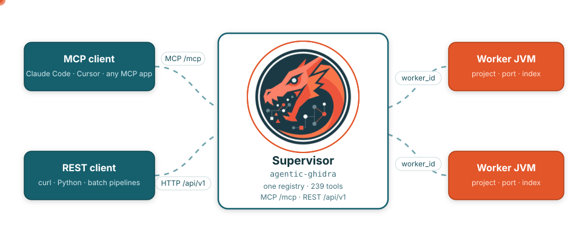
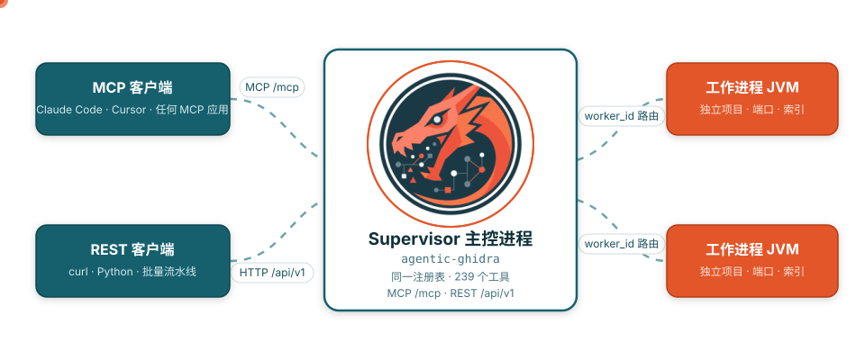

<p align="center">
  <a href="#english"></a>
  <a href="#zh"></a>
</p>

<p align="center">
  
</p>

<h1 align="center">Agentic-Ghidra</h1>

<p align="center"><em>Many agents, one Ghidra: agentic binary reverse engineering over a catalog of 212 headless operations.</em></p>

<p align="center">
  <a href="LICENSE"></a>
  
  
  
  
  
  
  
</p>

<a id="english"></a>

## English

Agentic-Ghidra started as a fork of [pyghidra-mcp](https://github.com/clearbluejar/pyghidra-mcp)
(v0.2.7), which ships twenty headless tools for pointing an MCP client at Ghidra. It has since
grown into a full agentic reverse engineering platform: a catalog of 212 operations (decompilation,
type reconstruction, patching, pcode, transactions), a supervisor that boots isolated JVM workers
on demand, team investigations where multiple agents analyze the same binary without stepping on
each other, and a scriptable REST API beside MCP with one registry serving both protocols.
Everything is validated against real Ghidra 12.1.4 on AArch64, ARM32, x86-64, and native Mach-O
ARM64.

### Requirements

| Requirement | Detail |
| --- | --- |
| OS | macOS or Linux, ARM64 or x86-64 |
| Python | 3.10 or newer, 3.12 in development |
| Java | JDK 21 |
| Ghidra | 12.1.4, with `GHIDRA_INSTALL_DIR` pointing at its folder |
| uv | for `uv sync` (or plain pip with `pip install -e .`) |

Release history: [CHANGELOG.md](CHANGELOG.md). Documentation under [docs/](docs/README.md) is
written for AI agents: the full LLM usage reference with every tool schema lives in
[docs/llm.txt](docs/llm.txt) (中文: [docs/llm-zh.txt](docs/llm-zh.txt)). Human documentation:
<https://www.agenticghidra.reverselabs.dev/>.

### How to use it (one picture)

<p align="center">
  
</p>

Start the supervisor once, then drive it from either side:

```bash
./run.sh
```

The script detects Ghidra (or use `GHIDRA_INSTALL_DIR`), runs `uv sync`, writes a default
worker config at `runtime/supervisor.json` on first use, and starts the supervisor on port
29840 (`PORT=...` to change). Pass `--config workers.json` for a custom worker layout.

### Via MCP

Point any MCP client at the supervisor and drive Ghidra by conversation: list binaries, decompile,
rename, rebuild structs, patch bytes, export. Workers start on demand and are routed by
`worker_id`; see `--help` for supervisor options (max active workers, per worker ports,
decompiler pool size).

```json
{
  "mcpServers": {
    "ghidra": { "url": "http://127.0.0.1:29840/mcp" }
  }
}
```

### Via REST

Same process and port as MCP. Every tool (212 advanced + 20 legacy + 7 management) is callable
by name with a JSON object of its input schema:

```bash
curl -s localhost:29950/health | jq .status
curl -s localhost:29950/api/v1/tools?family=decomp | jq '.count'
curl -s -XPOST localhost:29950/api/v1/tools/decomp.function \
  -H 'content-type: application/json' \
  -d '{"worker_id":"rest_smoke","session_id":"...","function_start":"00100438"}' | jq .result.code
```

| Endpoint | Purpose |
| --- | --- |
| `GET /health` | Liveness plus worker snapshot |
| `GET /api/v1/tools` | Tool catalog with input schemas |
| `GET /api/v1/tools/{name}` | Input schema of one tool |
| `POST /api/v1/tools/{name}` | Invoke any tool by name |
| `POST /api/v1/batch` | Sequential calls; `pipeline: true` feeds each result into the next call |
| `GET /api/v1/workers` | Worker snapshot |
| `POST /api/v1/workers/{id}/start` | Start a worker |
| `POST /api/v1/workers/{id}/stop` | Stop a worker |
| `POST /api/v1/workers/{id}/restart` | Restart a worker |
| `GET /api/v1/investigations` | List team investigations |
| `POST /api/v1/investigations` | Create a team investigation |
| `GET /api/v1/investigations/{id}` | One investigation in detail |
| `GET /api/v1/openapi.json` | Machine readable route list |

`GET /api/v1/tools` filters by `family`, `q` and `read_only`.

Every success returns the same envelope:

```json
{"status":"ok","tool":...,"duration_ms":...,"session_id":...,"result":...}
```

Errors map to HTTP by exception kind:

| Exception | HTTP |
| --- | --- |
| `ValueError` | 400 |
| `FileNotFoundError` | 404 |
| `PermissionError` | 403 |
| `TimeoutError` | 504 |
| unknown tool | 404 |

**Auth.** Dev mode (default, loopback) shares one `rest-local` owner. To lock `/api/v1/*` down,
pass `--rest-api-key <sha256-hex>` or set `GHIDRA_ADVANCED_REST_API_KEY`; clients then send
`Authorization: Bearer <token>` or `X-API-Key`. Each key is its own owner, so sessions stay
isolated per key.

### What is included

| Capability | What you get |
| --- | --- |
| Advanced catalog | 212 operations in 34 families plus the 20 legacy headless tools |
| Sessions and transactions | Explicit read/write modes, locks per program, undo/redo and revert |
| Worker supervisor | JVM workers on demand with isolated projects, ports and Chroma indexes |
| Investigations | Two or more teams on the same binary (common SHA-256), fully isolated |
| REST beside MCP | One registry, two protocols; chain calls from Python or curl |
| Trusted code policy | `ghidra.call`, `ghidra.eval` and `ghidra.script` stay off unless enabled |

Catalog integrity: source names from the legacy tools are preserved as aliases and never counted
as new capabilities. The equivalence matrix is pinned in
`src/pyghidra_mcp/advanced/reference_catalog.json`, and `python tools/check_catalog.py` fails
when `source_names - implemented_or_mapped != ∅`.

Every operation is session bound, and mutations invalidate the decompiler and index caches, so
the next read always sees current program state.

The three trusted code tools execute arbitrary code. With `--advanced-trusted-code` they are
session bound, time limited and logged with owner, session and write flags. Enable them only
for trusted local clients: the transports have no authentication, so never expose them to
untrusted networks.

### Verification

All acceptance evidence below was produced with real Ghidra 12.1.4 (headless, no mocks) and lives
under `runtime/acceptance/` when generated locally.

| Scope | Result |
| --- | --- |
| 212 advanced + 20 legacy ops, native Mach-O ARM64 | all pass (`native-all-evidence.json`) |
| 212 ops, ELF aarch64 / arm / x86_64 | all pass (`elf-all-evidence.json`) |
| Annotations, branch inversion and reopen, 4 architectures | 32/32 each (`annotations-*.json`) |
| Supervisor, 3 concurrent MCP clients, index rebuild | pass (`mcp-evidence.json`, 239 tools) |
| Same binary teams, isolated mutations, restart survival | pass (`investigations-evidence.json`) |
| REST pipeline over a real worker | pass (`rest-smoke.json`) |
| Unit suite with REST contract tests | 271 passed, 43 skipped without a local Ghidra |

Regenerate with:

```bash
GHIDRA_INSTALL_DIR=/path/to/ghidra .venv/bin/python tools/verify_advanced.py \
  --fixture runtime/acceptance/fixtures/native --output runtime/acceptance/native-all-evidence.json
GHIDRA_INSTALL_DIR=/path/to/ghidra .venv/bin/python tools/benchmark_workers.py \
  --binary runtime/acceptance/fixtures/native --counts 1 2 4 --iterations 12
```

### Parallel worker benchmark (same binary, 12 iterations)

| Workers | Concurrent decompile throughput | p95 latency | Boot (s, serialized) | Cold/warm import (s) | RSS per JVM |
| ---: | ---: | ---: | ---: | ---: | ---: |
| 1 | 63.5/s | 31 ms | 2.6 | 0.90 / 0.44 | 1006 MiB |
| 2 | 83.1/s | 35 ms | 2.6, 5.2 | 3.6→0.9 / ~0.5 | 874–1039 MiB |
| 4 | 128.1/s | 49 ms | 2.6…10.3 | 9.0→1.1 / ~0.6 | 745–912 MiB |

All runs: analysis overlap observed, `save`/reopen integrity true on every worker. Per stage
telemetry (`mcp_request`, `import`, `analyze`, `decompile`(+pool wait), `indexing`(+queue wait),
`program_lock_wait`) and JVM memory counters are recorded in `measurements.json`. Cold imports
degrade while workers boot concurrently (shared disk/CPU); warm imports stay ~0.5 s.

---

<a id="zh"></a>

## 简体中文

Agentic-Ghidra 起源于 [pyghidra-mcp](https://github.com/clearbluejar/pyghidra-mcp)（v0.2.7）的
fork，原项目提供二十个无头工具，用于让 MCP 客户端接入 Ghidra。此后它成长为完整的智能体
逆向分析平台：212 项操作目录（反编译、类型重建、打补丁、pcode、事务）、按需启动隔离 JVM
工作进程的 supervisor、多团队互不干扰地分析同一二进制的 investigation 机制，以及与 MCP
并列的可脚本化 REST API，同一份注册表服务两种协议。所有能力均在真实 Ghidra 12.1.4 上
验证，覆盖 AArch64、ARM32、x86-64 以及原生 Mach-O ARM64。

### 环境要求

| 要求 | 说明 |
| --- | --- |
| 操作系统 | macOS 或 Linux，ARM64 或 x86-64 |
| Python | 3.10 及以上，开发使用 3.12 |
| Java | JDK 21 |
| Ghidra | 12.1.4，`GHIDRA_INSTALL_DIR` 指向其安装目录 |
| uv | 用于 `uv sync`（或用 pip 执行 `pip install -e .`） |

发布历史见 [CHANGELOG.md](CHANGELOG.md)。[docs/](docs/README.md) 下的文档面向 AI 智能体：
面向 LLM 的完整使用参考（含全部工具 schema）见 [docs/llm.txt](docs/llm.txt)
（中文版 [docs/llm-zh.txt](docs/llm-zh.txt)）。面向人类的文档：<https://www.agenticghidra.reverselabs.dev/>。

### 一图看懂怎么用

<p align="center">
  
</p>

先启动一次 supervisor，然后从任意一侧驱动它：

```bash
./run.sh
```

脚本会自动检测 Ghidra（也可以用 `GHIDRA_INSTALL_DIR` 指定）、执行 `uv sync`、在首次运行时生成默认的 worker 配置 `runtime/supervisor.json`，并在端口 29840 启动 supervisor（用 `PORT=...` 修改）。需要自定义 worker 布局时传入 `--config workers.json`。

### 通过 MCP 使用

把任意 MCP 客户端指向 supervisor，用对话驱动 Ghidra：列出二进制、反编译、重命名、重建
结构体、打补丁、导出。工作进程按需启动，并按 `worker_id` 路由；supervisor 选项（最大
活跃工作进程数、每进程端口、反编译池大小）见 `--help`。

```json
{
  "mcpServers": {
    "ghidra": { "url": "http://127.0.0.1:29840/mcp" }
  }
}
```

### 通过 REST 使用

与 MCP 同进程同端口。每个工具（212 项高级 + 20 项遗留 + 7 项管理）都可按名称调用，
传入符合其输入 schema 的 JSON 对象：

```bash
curl -s localhost:29950/health | jq .status
curl -s localhost:29950/api/v1/tools?family=decomp | jq '.count'
curl -s -XPOST localhost:29950/api/v1/tools/decomp.function \
  -H 'content-type: application/json' \
  -d '{"worker_id":"rest_smoke","session_id":"...","function_start":"00100438"}' | jq .result.code
```

| 端点 | 用途 |
| --- | --- |
| `GET /health` | 存活状态与工作进程快照 |
| `GET /api/v1/tools` | 带输入 schema 的工具目录 |
| `GET /api/v1/tools/{name}` | 单个工具的输入 schema |
| `POST /api/v1/tools/{name}` | 按名称调用任意工具 |
| `POST /api/v1/batch` | 顺序调用；`pipeline: true` 会把每次结果喂给下一次调用 |
| `GET /api/v1/workers` | 工作进程快照 |
| `POST /api/v1/workers/{id}/start` | 启动工作进程 |
| `POST /api/v1/workers/{id}/stop` | 停止工作进程 |
| `POST /api/v1/workers/{id}/restart` | 重启工作进程 |
| `GET /api/v1/investigations` | 列出多团队调查 |
| `POST /api/v1/investigations` | 创建多团队调查 |
| `GET /api/v1/investigations/{id}` | 单个调查详情 |
| `GET /api/v1/openapi.json` | 机器可读的路由列表 |

`GET /api/v1/tools` 支持 `family`、`q`、`read_only` 过滤。

每次成功都返回同样的封装：

```json
{"status":"ok","tool":...,"duration_ms":...,"session_id":...,"result":...}
```

错误按异常类型映射为 HTTP 状态：

| 异常 | HTTP |
| --- | --- |
| `ValueError` | 400 |
| `FileNotFoundError` | 404 |
| `PermissionError` | 403 |
| `TimeoutError` | 504 |
| 未知工具 | 404 |

**鉴权**：开发模式（默认，回环地址）共用一个 `rest-local` 所有者。要给 `/api/v1/*` 上锁，
传入 `--rest-api-key <sha256-hex>` 或设置 `GHIDRA_ADVANCED_REST_API_KEY`；客户端随后发送
`Authorization: Bearer <token>` 或 `X-API-Key`。每个 key 都有独立的所有者，会话按 key 隔离。

### 包含内容

| 能力 | 你得到什么 |
| --- | --- |
| 高级操作目录 | 34 个族共 212 项操作，外加 20 个遗留无头工具 |
| 会话与事务 | 显式读写模式、按程序加锁、undo/redo 与 revert |
| 工作进程 supervisor | 按需启动 JVM 工作进程，项目、端口与 Chroma 索引彼此隔离 |
| 多团队调查 | 两个或更多团队分析同一二进制（相同 SHA-256），完全隔离 |
| 与 MCP 并列的 REST | 一份注册表，两种协议；用 Python 或 curl 串联调用 |
| 可信代码策略 | `ghidra.call`、`ghidra.eval`、`ghidra.script` 默认关闭，需显式开启 |

目录完整性：遗留工具的源名称保留为别名，且绝不计入新能力。等价矩阵固定在
`src/pyghidra_mcp/advanced/reference_catalog.json`；当
`source_names - implemented_or_mapped != ∅` 时，`python tools/check_catalog.py` 直接失败。

每个操作都绑定会话；变更会使反编译器与索引缓存失效，下一次读取总能看到最新的程序状态。

三个可信代码工具会执行任意代码。开启 `--advanced-trusted-code` 后，它们绑定会话、限时执行，
并以 owner、session、write 标志记录日志。仅对可信的本地客户端开启：传输层没有鉴权，
绝不要暴露给不受信任的网络。

### 验证

下表所有验收证据均由真实 Ghidra 12.1.4（无头、无 mock）产出，本地生成时位于
`runtime/acceptance/`。

| 范围 | 结果 |
| --- | --- |
| 212 项高级 + 20 项遗留操作，原生 Mach-O ARM64 | 全部通过（`native-all-evidence.json`） |
| 212 项操作，ELF aarch64 / arm / x86_64 | 全部通过（`elf-all-evidence.json`） |
| 注解、分支反转与重开持久化，4 种架构 | 每架构 32/32（`annotations-*.json`） |
| supervisor、3 个并发 MCP 客户端、索引重建 | 通过（`mcp-evidence.json`，239 个工具） |
| 同一二进制多团队、变更隔离、重启存活 | 通过（`investigations-evidence.json`） |
| 真实工作进程上的 REST 流水线 | 通过（`rest-smoke.json`） |
| 含 REST 契约测试的单元套件 | 本地 271 通过，43 跳过（无本地 Ghidra 时） |

重新生成：

```bash
GHIDRA_INSTALL_DIR=/path/to/ghidra .venv/bin/python tools/verify_advanced.py \
  --fixture runtime/acceptance/fixtures/native --output runtime/acceptance/native-all-evidence.json
GHIDRA_INSTALL_DIR=/path/to/ghidra .venv/bin/python tools/benchmark_workers.py \
  --binary runtime/acceptance/fixtures/native --counts 1 2 4 --iterations 12
```

### 并行工作进程基准（同一二进制，12 轮）

| 工作进程 | 并发反编译吞吐 | p95 延迟 | 启动（秒，串行） | 冷/热导入（秒） | 每 JVM RSS |
| ---: | ---: | ---: | ---: | ---: | ---: |
| 1 | 63.5/s | 31 ms | 2.6 | 0.90 / 0.44 | 1006 MiB |
| 2 | 83.1/s | 35 ms | 2.6, 5.2 | 3.6→0.9 / ~0.5 | 874–1039 MiB |
| 4 | 128.1/s | 49 ms | 2.6…10.3 | 9.0→1.1 / ~0.6 | 745–912 MiB |

所有轮次：观察到分析重叠，每个工作进程的 `save` 与重开完整性均为真。分阶段遥测
（`mcp_request`、`import`、`analyze`、`decompile`（含池等待）、`indexing`（含队列等待）、
`program_lock_wait`）与 JVM 内存计数记录在 `measurements.json`。多个工作进程并发启动时
冷导入会退化（磁盘与 CPU 共享）；热导入稳定在约 0.5 秒。
